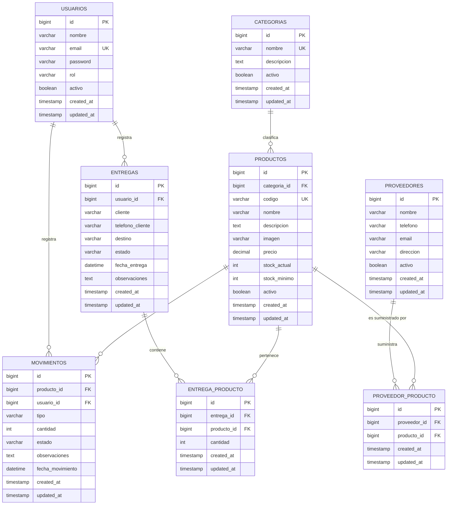

# SIGIP – Sistema de Gestión de Inventario y Pedidos para Spacio Muebles

**Integrantes:**

- [23410291 - Jorge Abdiel Hernández Ponce]
- [23410283 - Daniel Omar Soto Jiménez]
- [23410295 - Omar Gerardo López Alvarado]

---

## 1. Idea general

SIGIP (Sistema de Gestión de Inventario y Pedidos) es una aplicación web dirigida al dueño del negocio y al personal de ventas y almacén. SIGIP facilita el acceso al catálogo de productos, al registro de proveedores, a los movimientos de entrada y salida y al registro de pedidos, además cuenta un dashboard que muestra datos y estadísticas relevantes para el administrador del negocio. El propósito de SIGIP es ayudar a que negocios pequeños empiecen a digitalizarse, dejando atrás los registros manuales en hojas o cuadernos, o incluso aquellos que lo hacen digitalmente, pero sin conexión entre todas estas áreas. De esta manera, los negocios se verán beneficiados a la hora de reducir errores humanos y evitar pérdidas de información, logrando una gestión y funcionamiento del negocio más eficiente.

## 2. Descripción de entidades o módulos

| Entidad / Módulo | Descripción |
| --- | --- |
| **Usuarios** | Administra las cuentas del sistema y el rol (Administrador o Empleado). |
| **Categorías** | Clasifica los productos del catálogo (Salas, Recámaras, Comedores, etc). |
| **Productos** | Catálogo de artículos con código, nombre, descripción, categoría, precio, stock actual y stock mínimo. |
| **Proveedores** | Registro de los proveedores y de sus productos. |
| **Movimientos** | Registra entradas y salidas de los productos. |
| **Entregas** | Información de las entregas a realizar o ya realizadas |

Los módulos se relacionan así: un **Producto** pertenece a una **Categoría** y puede ser suministrado por uno o más **Proveedores**; cada **Movimiento de Inventario** y cada **Entrega** hace referencia a **Productos** y quedan asociados al **Usuario** que los generó.

## 3. Tipos de usuario (roles)

- **Administrador:** gestiona usuarios y roles, el catálogo de productos, los proveedores, revisa el historial completo de movimientos, ve el dashboard y genera los reportes del sistema.
- **Empleado:** consulta el catálogo, registra entradas y salidas, registra entregas y su estado. No tiene acceso a la gestión de usuarios ni a los reportes.

## 4. Servicios web

1. **Consulta pública de catálogo (JSON):** muestra el listado de productos disponibles (nombre, descripción, categoría, precio, existencia) en formato JSON, para ser usado en una aplicación web dirigida al cliente.
2. **Consulta de estado de pedido (JSON):** muestra la información de una entrega en específico, para ser usado como reporte o para darle información al empleado que realizara la entrega.

## 5. Procesos automáticos

1. **Alertas automáticas de stock bajo:** cuando la existencia de un producto llega a su stock mínimo o se agota, el sistema genera automáticamente una notificación (correo electrónico) para el Administrador.
2. **Alertas automáticas de pedidos no completados:** cuando la existencia de un pedido llega a 30 dias estando en estado Pendiente, el sistema genera automáticamente una notificación (correo electrónico) para el Administrador.

## 6. Requerimientos funcionales

| ID | Módulo | Nombre | Rol | Descripción del requerimiento | Prioridad |
| --- | --- | --- | --- | --- | --- |
| **RF-01** | Usuarios | Autenticar usuario | Sistema | El sistema solo dará acceso mediante correo y contraseña, limita lo que cada usuario puede ver según su rol. | Imprescindible |
| **RF-02** | Usuarios | Registrar usuario | Administrador | El sistema permitirá registrar nuevos usuarios asignándoles el rol de Administrador o Empleado. | Imprescindible |
| **RF-03** | Usuarios | Eliminar usuario | Administrador | El sistema permitirá eliminar usuarios. | Imprescindible |
| **RF-04** | Usuarios | Modificar usuario | Administrador | El sistema permitirá modificar los datos de un usuario y su rol. | Imprescindible |
| **RF-05** | Usuarios | Archivar usuario | Administrador | El sistema permitirá archivar a un usuario, deshabilitando el acceso del usuario al sistema y ocultándolo de registros y listas. | Imprescindible |
| **RF-06** | Usuarios | Consultar usuario | Administrador | El sistema permitirá consultar un usuario según su nombre, rol y otros datos | Imprescindible |
| **RF-07** | Productos | Registrar producto | Administrador | El sistema permitirá registrar un producto con código, nombre, descripción, categoría, precio, stock, stock mínimo e imagen. | Imprescindible |
| **RF-08** | Productos | Eliminar producto | Administrador | El sistema permitirá eliminar productos y toda su información. | Imprescindible |
| **RF-09** | Productos | Modificar producto | Administrador | El sistema permitirá modificar los datos de un producto. | Imprescindible |
| **RF-10** | Productos | Archivar producto | Administrador | El sistema permitirá archivar un producto, ocultándolo de listas, registros y de ser usable por los Empleados. | Imprescindible |
| **RF-11** | Productos | Consultar producto | Administrador, Empleado | El sistema permitirá consultar y filtrar productos según sus datos | Imprescindible |
| **RF-12** | Productos | Consultar catálogo | Administrador, Empleado | El sistema permitirá buscar o filtrar productos por nombre o categoría | Imprescindible |
| **RF-13** | Productos | Actualizar catálogo | Administrador, Empleado | El sistema permitirá actualizar el catálogo para reflejar cambios recientes | Imprescindible |
| **RF-14** | Productos | Modificar catálogo | Administrador | El sistema permitirá modificar el catálogo y los productos visibles en él. | Imprescindible
| **RF-15** | Proveedores | Registrar proveedor | Administrador | El sistema permitirá registrar los datos de contacto de un proveedor y sus productos. | Imprescindible |
| **RF-16** | Proveedores | Eliminar proveedor | Administrador | El sistema permitirá eliminar proveedores y toda su información. | Imprescindible |
| **RF-17** | Proveedores | Modificar proveedor | Administrador | El sistema permitirá modificar los datos de un proveedor. | Imprescindible |
| **RF-18** | Proveedores | Archivar proveedor | Administrador | El sistema permitirá archivar un proveedor, ocultándolo de listas, registros y de ser usable por los Empleados. | Imprescindible |
| **RF-19** | Proveedores | Consultar proveedor | Administrador | El sistema permitirá consultar y filtrar proveedores según sus datos o productos | Imprescindible |
| **RF-20** | Movimientos | Registrar entrada de mercancía | Administrador, Empleado | El sistema permitirá registrar una entrada de mercancía y actualiza el inventario actual automáticamente. | Imprescindible |
| **RF-21** | Movimientos | Registrar salida de mercancía | Administrador, Empleado | El sistema permitirá marcar una salida de mercancía y actualizar el inventario actual automáticamente | Imprescindible |
| **RF-22** | Movimientos | Cancelar entrada de mercancía | Administrador, Empleado | El sistema permitirá cancelar una entrada de mercancía y actualizar el inventario actual automáticamente | Imprescindible |
| **RF-23** | Movimientos | Cancelar salida de mercancía | Administrador, Empleado | El sistema permitirá cancelar una salida de mercancía y actualizar el inventario actual automáticamente | Imprescindible |
| **RF-24** | Movimientos | Modificar entrada de mercancía | Administrador, Empleado | El sistema permitirá modificar una entrada de mercancía y actualizar el inventario actual automáticamente | Imprescindible |
| **RF-25** | Movimientos | Modificar salida de mercancía | Administrador, Empleado | El sistema permitirá modificar una salida de mercancía y actualizar el inventario actual automáticamente | Imprescindible |
| **RF-26** | Movimientos | Consultar entrada de mercancía | Administrador, Empleado | El sistema permitirá consultar las entradas de mercancía y filtrarlas según sus datos | Imprescindible |
| **RF-27** | Movimientos | Consultar salida de mercancía | Administrador, Empleado | El sistema permitirá consultar las salidas de mercancía y filtrarlas según sus datos | Imprescindible |
| **RF-28** | Entregas | Crear entrega | Administrador, Empleado | El sistema permitirá crear una entrega, seleccionando productos, cantidades, destino, cliente y estado. | Imprescindible |
| **RF-29** | Entregas | Modificar entrega | Administrador, Empleado | El sistema permitirá actualizar la información y el estado de una entrega | Imprescindible |
| **RF-30** | Entregas | Eliminar entrega | Administrador | El sistema permitirá eliminar una entrega ya registrada | Imprescindible |
| **RF-31** | Entregas | Consultar entrega | Administrador, Empleado | El sistema permitirá consultar una entrega ya registrada según sus datos | Imprescindible |
| **RF-32** | Entregas | Validar disponibilidad de stock | Sistema | El sistema impedirá crear una entrega si no hay suficiente inventario del producto a entregar | Imprescindible |
| **RF-33** | Dashboard | Visualizar dashboard | Administrador | El sistema mostrará información y estadísticas elegidas por el Administrador entre varias opciones disponibles. | Imprescindible |
| **RF-34** | Categorías | Crear categoría | Administrador | El sistema permitirá crear una categoría para ser asignada a los productos | Imprescindible |
| **RF-35** | Categorías | Modificar categoría | Administrador | El sistema permitirá modificar una categoría y actualizar automáticamente el sistema con los cambios. | Imprescindible |
| **RF-36** | Categorías | Archivar categoría | Administrador | El sistema permitirá archivar una categoria, deshabilitándola de ser usada por el Empleado y ocultándola a la vista | Imprescindible |
| **RF-37** | Categorías | Eliminar categoría | Administrador | El sistema permitirá eliminar una categoría y actualizar automáticamente el sistema con los cambios | Imprescindible |
| **RF-38** | Categorías | Consultar categoría | Administrador, Empleado | El sistema permitirá consultar una categoría y mostrar sus datos | Imprescindible |
| **RF-39** | Reportes | Generar catalogo | Sistema, Administrador | El sistema permitirá generar un catálogo en un formato apto para ser usado de manera externa | Imprescindible |
| **RF-40** | Reportes | Generar reporte de entrega | Sistema, Administrador, Empleado | El sistema permitirá generar un reporte de una o varias entregas en específico en un formato apto para ser usado de manera externa | Imprescindible |
| **RF-41** | Alertas | Alertar stock mínimo | Sistema | El sistema mandará un correo al administrador cuando un producto se encuentre en su stock mínimo. | Imprescindible |
| **RF-42** | Alertas | Alerta pedido no completado | Sistema | El sistema mandará un correo al administrador cuando un pedido lleve 30 dias en estado Pendiente. | Imprescindible |

## Actualización:

Cambiamos la generacion automática de reportes por otro proceso automático gracias a la corrección del profesor. El nuevo proceso automático será una alerta automática cuando un pedido siga estando en estado Pendiente a los 30 días desde que se generó. Esto con el proposito de avisar al administrador para que pueda revisar si el pedido no se marcó como Completado o Cancelado por error, o si no se ha realizado su entrega por alguna razón.

## Criterios de Aceptación

#### RF-01 – Autenticar usuario

**Escenario A: Flujo de Éxito**
Dado que el usuario ingresó un correo y una contraseña registrados, cuando presione el botón «Iniciar sesión», entonces el sistema le dará acceso y solo mostrará las secciones permitidas para su rol.

**Escenario B: Flujo de Validación o Excepción**
- Dado que el usuario ingresó un correo o una contraseña incorrectos, cuando presione el botón «Iniciar sesión», entonces el sistema no le dará acceso y mostrará el mensaje: «Correo o contraseña incorrectos».
- Dado que un Empleado intenta entrar a una sección exclusiva del Administrador, cuando solicite esa sección, entonces el sistema le negará el acceso y mostrará el mensaje: «No cuenta con permisos para acceder a esta sección».

#### RF-02 – Registrar usuario

**Escenario A: Flujo de Éxito**
Dado que el Administrador ingresó nombre, correo, contraseña y rol válidos, cuando presione el botón «Guardar», entonces el sistema registrará al usuario con el rol asignado y mostrará un mensaje de confirmación.

**Escenario B: Flujo de Validación o Excepción**
- Dado que el correo ingresado ya pertenece a otro usuario, cuando presione el botón «Guardar», entonces el sistema no guardará la información y mostrará el mensaje: «El correo ya se encuentra registrado».
- Dado que falta algún dato obligatorio, cuando presione el botón «Guardar», entonces el sistema no guardará la información y mostrará un mensaje indicando los campos faltantes.

#### RF-03 – Eliminar usuario

**Escenario A: Flujo de Éxito**
Dado que el Administrador seleccionó un usuario existente, cuando confirme su eliminación, entonces el sistema eliminará al usuario, ya no podrá acceder al sistema y se mostrará un mensaje de confirmación.

**Escenario B: Flujo de Validación o Excepción**
Dado que un Empleado intenta eliminar un usuario, cuando realice la acción, entonces el sistema no la permitirá y mostrará el mensaje: «No cuenta con permisos para realizar esta acción».

#### RF-04 – Modificar usuario

**Escenario A: Flujo de Éxito**
Dado que el Administrador modificó los datos o el rol de un usuario con valores válidos, cuando presione el botón «Guardar», entonces el sistema actualizará la información y el nuevo rol se aplicará en el siguiente inicio de sesión del usuario.

**Escenario B: Flujo de Validación o Excepción**
Dado que el correo ingresado ya pertenece a otro usuario, cuando presione el botón «Guardar», entonces el sistema no guardará los cambios y mostrará el mensaje: «El correo ya se encuentra registrado».

#### RF-05 – Archivar usuario

**Escenario A: Flujo de Éxito**
Dado que el Administrador seleccionó un usuario activo, cuando lo archive, entonces el sistema deshabilitará su acceso y lo ocultará de registros y listas.

**Escenario B: Flujo de Validación o Excepción**
Dado que un usuario está archivado, cuando intente iniciar sesión, entonces el sistema no le dará acceso y mostrará el mensaje: «Su cuenta se encuentra deshabilitada».

#### RF-06 – Consultar usuario

**Escenario A: Flujo de Éxito**
Dado que el Administrador ingresó un nombre, rol u otro dato de búsqueda, cuando realice la consulta, entonces el sistema mostrará la lista de usuarios que coincidan con los datos ingresados.

**Escenario B: Flujo de Validación o Excepción**
Dado que ningún usuario coincide con los datos ingresados, cuando realice la consulta, entonces el sistema mostrará el mensaje: «No se encontraron resultados».

#### RF-07 – Registrar producto

**Escenario A: Flujo de Éxito**
Dado que el Administrador ingresó código, nombre, descripción, categoría, precio, stock, stock mínimo e imagen válidos, cuando presione el botón «Guardar», entonces el sistema registrará el producto y mostrará un mensaje de confirmación.

**Escenario B: Flujo de Validación o Excepción**
- Dado que el código ingresado ya pertenece a otro producto, cuando presione el botón «Guardar», entonces el sistema no guardará la información y mostrará el mensaje: «El código ya se encuentra registrado».
- Dado que falta algún dato obligatorio o que el precio, el stock o el stock mínimo tienen un valor negativo, cuando presione el botón «Guardar», entonces el sistema no guardará la información y mostrará un mensaje indicando los campos con error.

#### RF-08 – Eliminar producto

**Escenario A: Flujo de Éxito**
Dado que el Administrador seleccionó un producto existente, cuando confirme su eliminación, entonces el sistema eliminará el producto junto con toda su información y mostrará un mensaje de confirmación.

**Escenario B: Flujo de Validación o Excepción**
Dado que un Empleado intenta eliminar un producto, cuando realice la acción, entonces el sistema no la permitirá y mostrará el mensaje: «No cuenta con permisos para realizar esta acción».

#### RF-09 – Modificar producto

**Escenario A: Flujo de Éxito**
Dado que el Administrador modificó los datos de un producto con valores válidos, cuando presione el botón «Guardar», entonces el sistema actualizará la información del producto y mostrará un mensaje de confirmación.

**Escenario B: Flujo de Validación o Excepción**
Dado que el código ingresado ya pertenece a otro producto o que el precio, el stock o el stock mínimo tienen un valor negativo, cuando presione el botón «Guardar», entonces el sistema no guardará los cambios y mostrará un mensaje indicando los campos con error.

#### RF-10 – Archivar producto

**Escenario A: Flujo de Éxito**
Dado que el Administrador seleccionó un producto activo, cuando lo archive, entonces el sistema lo ocultará de listas y registros y ya no podrá ser usado por los Empleados.

**Escenario B: Flujo de Validación o Excepción**
Dado que un producto está archivado, cuando un Empleado registre un movimiento o una entrega, entonces el sistema no mostrará ese producto como opción disponible.

#### RF-11 – Consultar producto

**Escenario A: Flujo de Éxito**
Dado que el usuario ingresó uno o varios filtros de búsqueda (código, nombre, categoría, etc.), cuando realice la consulta, entonces el sistema mostrará los productos que coincidan con los filtros.

**Escenario B: Flujo de Validación o Excepción**
Dado que ningún producto coincide con los filtros ingresados, cuando realice la consulta, entonces el sistema mostrará el mensaje: «No se encontraron resultados».

#### RF-12 – Consultar catálogo

**Escenario A: Flujo de Éxito**
Dado que el usuario ingresó un nombre o seleccionó una categoría, cuando realice la búsqueda, entonces el sistema mostrará los productos del catálogo que coincidan.

**Escenario B: Flujo de Validación o Excepción**
Dado que ningún producto del catálogo coincide con el nombre o la categoría indicados, cuando realice la búsqueda, entonces el sistema mostrará el mensaje: «No se encontraron resultados».

#### RF-13 – Actualizar catálogo

**Escenario A: Flujo de Éxito**
Dado que se registraron o modificaron productos recientemente, cuando el usuario actualice el catálogo, entonces el sistema mostrará la información más reciente de los productos.

**Escenario B: Flujo de Validación o Excepción**
Dado que un producto fue archivado, cuando el usuario actualice el catálogo, entonces el sistema ya no mostrará ese producto en el catálogo.

#### RF-14 – Modificar catálogo

**Escenario A: Flujo de Éxito**
Dado que el Administrador seleccionó los productos que serán visibles en el catálogo, cuando presione el botón «Guardar», entonces el sistema actualizará el catálogo y solo mostrará los productos seleccionados.

**Escenario B: Flujo de Validación o Excepción**
Dado que un Empleado intenta modificar el catálogo, cuando realice la acción, entonces el sistema no la permitirá y mostrará el mensaje: «No cuenta con permisos para realizar esta acción».

#### RF-15 – Registrar proveedor

**Escenario A: Flujo de Éxito**
Dado que el Administrador ingresó los datos de contacto del proveedor y sus productos de forma válida, cuando presione el botón «Guardar», entonces el sistema registrará al proveedor y mostrará un mensaje de confirmación.

**Escenario B: Flujo de Validación o Excepción**
Dado que falta algún dato obligatorio, cuando presione el botón «Guardar», entonces el sistema no guardará la información y mostrará un mensaje indicando los campos faltantes.

#### RF-16 – Eliminar proveedor

**Escenario A: Flujo de Éxito**
Dado que el Administrador seleccionó un proveedor existente, cuando confirme su eliminación, entonces el sistema eliminará al proveedor junto con toda su información y mostrará un mensaje de confirmación.

**Escenario B: Flujo de Validación o Excepción**
Dado que un Empleado intenta eliminar un proveedor, cuando realice la acción, entonces el sistema no la permitirá y mostrará el mensaje: «No cuenta con permisos para realizar esta acción».

#### RF-17 – Modificar proveedor

**Escenario A: Flujo de Éxito**
Dado que el Administrador modificó los datos de un proveedor con valores válidos, cuando presione el botón «Guardar», entonces el sistema actualizará la información y mostrará un mensaje de confirmación.

**Escenario B: Flujo de Validación o Excepción**
Dado que el Administrador dejó vacío algún dato obligatorio, cuando presione el botón «Guardar», entonces el sistema no guardará los cambios y mostrará un mensaje indicando los campos faltantes.

#### RF-18 – Archivar proveedor

**Escenario A: Flujo de Éxito**
Dado que el Administrador seleccionó un proveedor activo, cuando lo archive, entonces el sistema lo ocultará de listas y registros y ya no podrá ser usado por los Empleados.

**Escenario B: Flujo de Validación o Excepción**
Dado que un proveedor está archivado, cuando un Empleado necesite seleccionar un proveedor, entonces el sistema no mostrará al proveedor archivado como opción disponible.

#### RF-19 – Consultar proveedor

**Escenario A: Flujo de Éxito**
Dado que el Administrador ingresó uno o varios filtros (datos del proveedor o producto), cuando realice la consulta, entonces el sistema mostrará los proveedores que coincidan con los filtros.

**Escenario B: Flujo de Validación o Excepción**
Dado que ningún proveedor coincide con los filtros ingresados, cuando realice la consulta, entonces el sistema mostrará el mensaje: «No se encontraron resultados».

#### RF-20 – Registrar entrada de mercancía

**Escenario A: Flujo de Éxito**
Dado que el usuario seleccionó un producto e ingresó una cantidad válida, cuando presione el botón «Guardar», entonces el sistema registrará la entrada, sumará la cantidad al stock actual del producto y la asociará al usuario que la generó.

**Escenario B: Flujo de Validación o Excepción**
Dado que la cantidad ingresada es cero, negativa o está vacía, cuando presione el botón «Guardar», entonces el sistema no registrará la entrada y mostrará el mensaje: «La cantidad debe ser mayor a cero».

#### RF-21 – Registrar salida de mercancía

**Escenario A: Flujo de Éxito**
Dado que el usuario seleccionó un producto e ingresó una cantidad menor o igual al stock actual, cuando presione el botón «Guardar», entonces el sistema registrará la salida, restará la cantidad al stock actual del producto y la asociará al usuario que la generó.

**Escenario B: Flujo de Validación o Excepción**
Dado que la cantidad ingresada es mayor al stock actual del producto, cuando presione el botón «Guardar», entonces el sistema no registrará la salida y mostrará el mensaje: «Existencia insuficiente del producto».

#### RF-22 – Cancelar entrada de mercancía

**Escenario A: Flujo de Éxito**
Dado que el usuario seleccionó una entrada activa, cuando la cancele, entonces el sistema marcará la entrada como cancelada y restará la cantidad de esa entrada al stock actual del producto.

**Escenario B: Flujo de Validación o Excepción**
Dado que el stock actual del producto es menor a la cantidad de la entrada, cuando el usuario intente cancelarla, entonces el sistema no realizará la cancelación y mostrará el mensaje: «No es posible cancelar la entrada porque la existencia quedaría negativa».

#### RF-23 – Cancelar salida de mercancía

**Escenario A: Flujo de Éxito**
Dado que el usuario seleccionó una salida activa, cuando la cancele, entonces el sistema marcará la salida como cancelada y sumará la cantidad de esa salida al stock actual del producto.

**Escenario B: Flujo de Validación o Excepción**
Dado que la salida ya fue cancelada, cuando el usuario intente cancelarla de nuevo, entonces el sistema no modificará el inventario y mostrará el mensaje: «La salida ya se encuentra cancelada».

#### RF-24 – Modificar entrada de mercancía

**Escenario A: Flujo de Éxito**
Dado que el usuario modificó los datos de una entrada con valores válidos, cuando presione el botón «Guardar», entonces el sistema actualizará la entrada y ajustará el stock actual del producto según la diferencia de cantidad.

**Escenario B: Flujo de Validación o Excepción**
Dado que la modificación dejaría el stock actual del producto en un valor negativo, cuando presione el botón «Guardar», entonces el sistema no guardará los cambios y mostrará el mensaje: «La modificación dejaría la existencia negativa».

#### RF-25 – Modificar salida de mercancía

**Escenario A: Flujo de Éxito**
Dado que el usuario modificó los datos de una salida con valores válidos, cuando presione el botón «Guardar», entonces el sistema actualizará la salida y ajustará el stock actual del producto según la diferencia de cantidad.

**Escenario B: Flujo de Validación o Excepción**
Dado que la nueva cantidad de la salida es mayor al stock disponible del producto, cuando presione el botón «Guardar», entonces el sistema no guardará los cambios y mostrará el mensaje: «Existencia insuficiente del producto».

#### RF-26 – Consultar entrada de mercancía

**Escenario A: Flujo de Éxito**
Dado que el usuario ingresó uno o varios filtros (producto, fecha, usuario, etc.), cuando realice la consulta, entonces el sistema mostrará las entradas que coincidan con los filtros.

**Escenario B: Flujo de Validación o Excepción**
Dado que ninguna entrada coincide con los filtros ingresados, cuando realice la consulta, entonces el sistema mostrará el mensaje: «No se encontraron resultados».

#### RF-27 – Consultar salida de mercancía

**Escenario A: Flujo de Éxito**
Dado que el usuario ingresó uno o varios filtros (producto, fecha, usuario, etc.), cuando realice la consulta, entonces el sistema mostrará las salidas que coincidan con los filtros.

**Escenario B: Flujo de Validación o Excepción**
Dado que ninguna salida coincide con los filtros ingresados, cuando realice la consulta, entonces el sistema mostrará el mensaje: «No se encontraron resultados».

#### RF-28 – Crear entrega

**Escenario A: Flujo de Éxito**
Dado que el usuario seleccionó productos, cantidades, destino, cliente y estado válidos, cuando presione el botón «Guardar», entonces el sistema registrará la entrega, la asociará al usuario que la generó y mostrará un mensaje de confirmación.

**Escenario B: Flujo de Validación o Excepción**
Dado que falta algún dato obligatorio de la entrega, cuando presione el botón «Guardar», entonces el sistema no guardará la información y mostrará un mensaje indicando los campos faltantes.

#### RF-29 – Modificar entrega

**Escenario A: Flujo de Éxito**
Dado que el usuario modificó la información o el estado de una entrega con valores válidos, cuando presione el botón «Guardar», entonces el sistema actualizará la entrega y mostrará un mensaje de confirmación.

**Escenario B: Flujo de Validación o Excepción**
Dado que el usuario dejó vacío algún dato obligatorio de la entrega, cuando presione el botón «Guardar», entonces el sistema no guardará los cambios y mostrará un mensaje indicando los campos faltantes.

#### RF-30 – Eliminar entrega

**Escenario A: Flujo de Éxito**
Dado que el Administrador seleccionó una entrega registrada, cuando confirme su eliminación, entonces el sistema eliminará la entrega y mostrará un mensaje de confirmación.

**Escenario B: Flujo de Validación o Excepción**
Dado que un Empleado intenta eliminar una entrega, cuando realice la acción, entonces el sistema no la permitirá y mostrará el mensaje: «No cuenta con permisos para realizar esta acción».

#### RF-31 – Consultar entrega

**Escenario A: Flujo de Éxito**
Dado que el usuario ingresó uno o varios datos de búsqueda (cliente, destino, estado, fecha, etc.), cuando realice la consulta, entonces el sistema mostrará las entregas que coincidan con los datos ingresados.

**Escenario B: Flujo de Validación o Excepción**
Dado que ninguna entrega coincide con los datos ingresados, cuando realice la consulta, entonces el sistema mostrará el mensaje: «No se encontraron resultados».

#### RF-32 – Validar disponibilidad de stock

**Escenario A: Flujo de Éxito**
Dado que la cantidad solicitada de cada producto es menor o igual a su stock actual, cuando se cree la entrega, entonces el sistema permitirá registrarla.

**Escenario B: Flujo de Validación o Excepción**
Dado que la cantidad solicitada de un producto es mayor a su stock actual, cuando se intente crear la entrega, entonces el sistema no la guardará y mostrará el mensaje: «Existencia insuficiente del producto [nombre del producto]».

#### RF-33 – Visualizar dashboard

**Escenario A: Flujo de Éxito**
Dado que el Administrador eligió una o varias de las estadísticas disponibles, cuando abra el dashboard, entonces el sistema mostrará únicamente las estadísticas elegidas con la información actualizada.

**Escenario B: Flujo de Validación o Excepción**
- Dado que un Empleado intenta acceder al dashboard, cuando solicite esa sección, entonces el sistema le negará el acceso y mostrará el mensaje: «No cuenta con permisos para acceder a esta sección».
- Dado que no existen registros para la estadística elegida, cuando abra el dashboard, entonces el sistema mostrará el mensaje: «No hay datos para mostrar».

#### RF-34 – Crear categoría

**Escenario A: Flujo de Éxito**
Dado que el Administrador ingresó un nombre de categoría válido, cuando presione el botón «Guardar», entonces el sistema registrará la categoría y estará disponible para ser asignada a los productos.

**Escenario B: Flujo de Validación o Excepción**
Dado que el nombre ingresado ya existe o está vacío, cuando presione el botón «Guardar», entonces el sistema no guardará la información y mostrará un mensaje indicando el error.

#### RF-35 – Modificar categoría

**Escenario A: Flujo de Éxito**
Dado que el Administrador modificó los datos de una categoría con valores válidos, cuando presione el botón «Guardar», entonces el sistema actualizará la categoría y los cambios se reflejarán en los productos asociados.

**Escenario B: Flujo de Validación o Excepción**
Dado que el nuevo nombre ya pertenece a otra categoría o está vacío, cuando presione el botón «Guardar», entonces el sistema no guardará los cambios y mostrará un mensaje indicando el error.

#### RF-36 – Archivar categoría

**Escenario A: Flujo de Éxito**
Dado que el Administrador seleccionó una categoría activa, cuando la archive, entonces el sistema la ocultará de la vista y ya no podrá ser usada por los Empleados.

**Escenario B: Flujo de Validación o Excepción**
Dado que una categoría está archivada, cuando se consulten las categorías disponibles para asignar a un producto, entonces el sistema no mostrará la categoría archivada.

#### RF-37 – Eliminar categoría

**Escenario A: Flujo de Éxito**
Dado que el Administrador seleccionó una categoría existente, cuando confirme su eliminación, entonces el sistema eliminará la categoría, actualizará la información que dependa de ella y mostrará un mensaje de confirmación.

**Escenario B: Flujo de Validación o Excepción**
Dado que un Empleado intenta eliminar una categoría, cuando realice la acción, entonces el sistema no la permitirá y mostrará el mensaje: «No cuenta con permisos para realizar esta acción».

#### RF-38 – Consultar categoría

**Escenario A: Flujo de Éxito**
Dado que el usuario seleccionó o buscó una categoría existente, cuando realice la consulta, entonces el sistema mostrará los datos de la categoría.

**Escenario B: Flujo de Validación o Excepción**
Dado que ninguna categoría coincide con la búsqueda, cuando realice la consulta, entonces el sistema mostrará el mensaje: «No se encontraron resultados».

#### RF-39 – Generar catálogo

**Escenario A: Flujo de Éxito**
Dado que existen productos visibles en el catálogo, cuando el Administrador solicite generar el catálogo, entonces el sistema generará un archivo descargable con los productos del catálogo.

**Escenario B: Flujo de Validación o Excepción**
Dado que no hay productos visibles en el catálogo, cuando se solicite generar el catálogo, entonces el sistema no generará el archivo y mostrará el mensaje: «No hay productos disponibles para generar el catálogo».

#### RF-40 – Generar reporte de entrega

**Escenario A: Flujo de Éxito**
Dado que el usuario seleccionó una o varias entregas, cuando solicite generar el reporte, entonces el sistema generará un archivo descargable con la información de las entregas seleccionadas.

**Escenario B: Flujo de Validación o Excepción**
Dado que el usuario no seleccionó ninguna entrega, cuando solicite generar el reporte, entonces el sistema no generará el archivo y mostrará el mensaje: «Debe seleccionar al menos una entrega».

#### RF-41 – Alertar stock mínimo

**Escenario A: Flujo de Éxito**
Dado que el stock actual de un producto llegó a su stock mínimo o se agotó, cuando el sistema actualice el inventario, entonces enviará un correo al Administrador indicando el producto y su stock actual.

**Escenario B: Flujo de Validación o Excepción**
Dado que el stock actual de un producto sigue por encima de su stock mínimo, cuando el sistema actualice el inventario, entonces no enviará ningún correo al Administrador.

#### RF-42 – Generar reporte periódico

**Escenario A: Flujo de Éxito**
Dado que se cumplió el lapso de tiempo establecido, cuando el sistema ejecute la generación programada, entonces generará el reporte de movimientos y entregas de ese lapso y lo enviará por correo al Administrador.

**Escenario B: Flujo de Validación o Excepción**
Dado que no hubo movimientos ni entregas durante el lapso establecido, cuando el sistema ejecute la generación programada, entonces generará el reporte indicando que no hubo registros y lo enviará por correo al Administrador.

## 7. Diagrama Entidad-Relación

El siguiente diagrama representa la estructura relacional para la base de datos de SIGIP.

